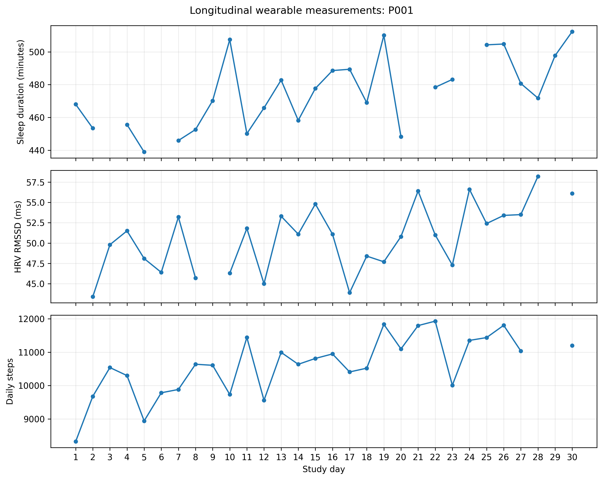

# Longitudinal Wearable Visualization

A modular Python toolkit for visualizing longitudinal sleep, heart rate variability (HRV), and physical activity measurements using synthetic data.

## Overview

Wearable devices generate repeated measurements that can reveal changes within individuals over time. Visualizing these observations requires attention to temporal alignment, missing measurements, between-participant heterogeneity, and appropriate measurement scales.

This repository demonstrates reusable Python functions for exploring and communicating longitudinal wearable data.

All example data are synthetic.

## Example Visualization

The figure below demonstrates aligned longitudinal measurements of sleep duration, heart rate variability (HRV), and daily steps for a fictional participant. Each variable is displayed on a separate axis, with missing observations preserved as gaps.



*All measurements are synthetic and intended for demonstration purposes only.*

## Visualization Capabilities

| Module | Functionality |
|---|---|
| `trajectories.py` | Individual longitudinal trajectories with missing-data gaps |
| `comparisons.py` | Between-participant trajectories and observed group means |
| `missingness.py` | Participant-by-day data availability heatmaps |
| `multivariable.py` | Aligned sleep, HRV, and activity trajectories |
| `export.py` | High-resolution PNG and vector PDF exports |

## Repository Structure

```text
longitudinal-wearable-visualization/
├── data/
│   └── synthetic_longitudinal_data.csv
├── figures/
│   ├── synthetic_multivariable_P001.png
│   └── synthetic_multivariable_P001.pdf
├── notebooks/
│   └── visualization_demo.ipynb
├── src/
│   └── wearable_visualization/
│       ├── __init__.py
│       ├── trajectories.py
│       ├── comparisons.py
│       ├── missingness.py
│       ├── multivariable.py
│       └── export.py
├── tests/
│   └── test_visualizations.py
├── README.md
├── requirements.txt
└── .gitignore
```

## Installation

Install the required Python packages from the repository root:

```bash
pip install -r requirements.txt
```

## Demonstration Notebook

Open `notebooks/visualization_demo.ipynb` in Jupyter and run all cells.

The notebook demonstrates individual trajectories, participant comparisons, missing-data heatmaps, aligned multivariable plots, and figure exports.

## Testing

Run the automated test suite from the repository root:

```bash
python -m pytest -v
```

The six automated tests verify expected behavior for trajectory plotting, participant selection, group means, missingness representation, multivariable panels, and figure exports.

## Data and Limitations

The synthetic dataset contains 30 days of observations for 20 fictional participants, with simulated increasing, decreasing, stable, and fluctuating temporal patterns.

Missing measurements are preserved rather than imputed. Observed group means are calculated from available measurements, so the number of contributing participants may vary across days.

These visualizations are exploratory and descriptive. They do not establish causal relationships or represent validated clinical biomarkers.

## Research Context

This project demonstrates reproducible scientific visualization methods applicable to intensive longitudinal wearable data. It emphasizes transparent representation of individual heterogeneity, temporal patterns, and missing observations without disclosing unpublished study-specific research methods.
